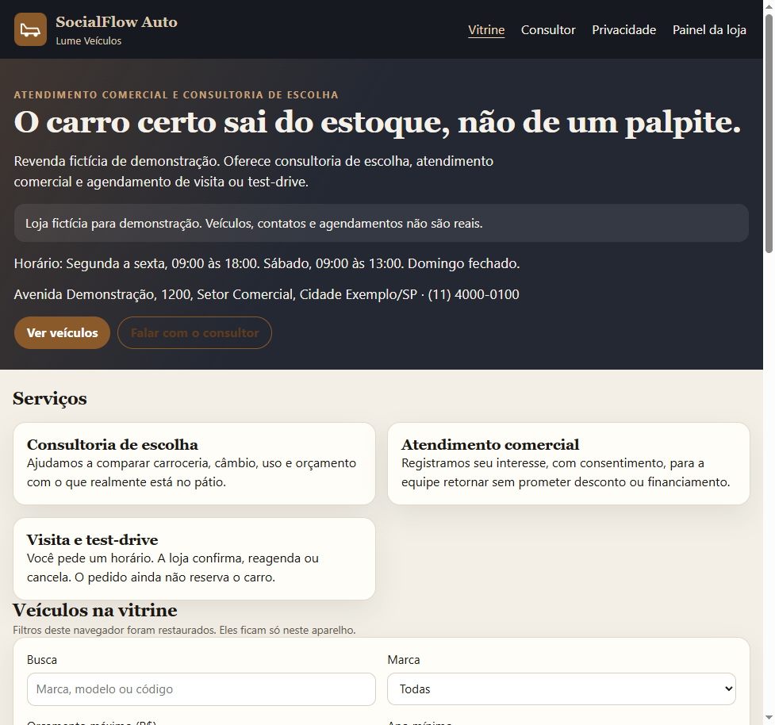

# SocialFlow Auto — Lume Veículos

Plataforma web de vitrine, consultoria de escolha e painel comercial para uma revendedora **fictícia**.

Este repositório é o trabalho da disciplina *Padrões Web para No Code e Low Code* e também o registro do projeto no meu portfólio de Desenvolvimento de Software e Automação.

**Demonstração pública (HTTPS):** [https://lume-veiculos.vercel.app](https://lume-veiculos.vercel.app)

**Ambiente de estudo no computador:** `http://127.0.0.1:8080`

---

## Sobre o projeto

O SocialFlow Auto é o sistema. A **Lume Veículos** é a loja de demonstração que vive dentro dele.

Na prática, o visitante vê o estoque, conversa com a assistente **Luna**, registra interesse ou pede uma visita. A equipe entra no **CRM** (`/painel`) para acompanhar leads, confirmar horários e cuidar do cadastro.

Não é uma loja real. Os dados de pessoas no seed são fictícios. O objetivo é mostrar um fluxo completo — do anúncio até o atendimento — com regras no servidor, e não só uma página estática.

---

## Problema identificado

Revenda pequena costuma atender por mensagem solta. O cliente não vê o que está no pátio, o vendedor repete preço de memória e a visita é combinada sem registro.

Isso gera três falhas simples:

- sugerir carro que já foi vendido;
- prometer condição que não está no cadastro;
- perder o histórico de quem pediu retorno.

A disciplina pede uma pequena empresa de **serviços**. A Lume entra nesse recorte pela consultoria de escolha, pelo atendimento comercial e pelo agendamento de visita ou test-drive — além de exibir o estoque.

---

## Objetivo da solução

- Publicar só o que está **disponível** (ou reservado, na ficha, conforme a regra da vitrine).
- Deixar a pessoa filtrar, comparar e pedir contato **com consentimento**.
- Fazer a Luna responder com base no estoque, não com palpite.
- Dar à equipe um painel para indicadores, leads e visitas.
- Permitir que a loja mude textos, expediente e cor **sem editar código**.

---

## Público-alvo

| Quem | O que faz no sistema |
| --- | --- |
| Visitante | Navega na vitrine, fala com a Luna, envia interesse ou pede visita |
| Vendas | Trata leads e agenda que lhe cabem |
| Administração | Vê a loja inteira, cadastra estoque, configura a loja e restaura a demonstração |

---

## Principais funcionalidades

### Vitrine

- Lista de veículos com busca, filtro e ordenação.
- Ficha do carro, interesse e pedido de visita (o pedido nasce **solicitado**; a loja confirma depois).
- Mensagem a um consultor escolhido.
- Consentimento obrigatório nos formulários de contato.
- Página de privacidade em `/privacidade`.

### Painel (CRM)

- Tela de login própria da equipe.
- Indicadores (leads, estoque, série do período).
- Estoque da loja (cadastro e mudança de status **só pela administração**).
- Leads com status e responsável.
- Visitas: confirmar ou reagendar, sem sobrepor horário já ocupado no mesmo veículo.
- Configuração da loja (nome, horários, cor, textos).

### Luna

- Balão na vitrine: busca, comparação, simulação simples de valores e encaminhamento a um consultor.
- Sem chave de IA, ela continua no script do estoque.
- Com Gemini no servidor, ela só **reescreve** o texto já fundamentado. Se o modelo inventar dado, a resposta é descartada.
- O texto livre da conversa **não** é gravado no banco.

---

## Tecnologias e ferramentas utilizadas

| Camada | O que usei | Para quê |
| --- | --- | --- |
| Interface | HTML, CSS e JavaScript | Telas, layout, Luna e painel |
| Backend | Python | API, validação, sessão e regras |
| Banco no PC | MariaDB/MySQL (XAMPP) | Dados da loja no dia a dia de desenvolvimento |
| Testes | SQLite temporário | `python -m unittest discover -s tests -v` |
| IA | Gemini (Google) | Redação da Luna; chave só no servidor |
| Publicação | Vercel | HTTPS em `.vercel.app` |

Não construí o site em Softr, Webflow, Framer ou Glide. Essas ferramentas pedem conta e encaixam mal estoque + sessão + papéis + IA sem expor chave no navegador.

O que fica próximo de *low-code* na **operação** é o painel: a loja altera textos e expediente sem abrir o código. A Vercel entra como publicação, não como construtor visual.

---

## Aplicação de HTML, CSS e JavaScript

Não usei essas linguagens “para cumprir lista”. Elas são a interface do produto.

**HTML.** Páginas `index.html`, `veiculo.html`, `painel.html` e `privacidade.html`. Há `lang="pt-BR"`, `main`, `nav`, rótulos nos campos, `dialog` de contato, link para pular ao conteúdo e atributos `aria-*`. O login do CRM não reutiliza a grade da vitrine — isso quebrava o texto na tela estreita.

**CSS.** Um arquivo `css/socialflow.css`: tema escuro, dourado da marca, unidades `rem` e `clamp`, grade, foco visível e versão em uma coluna no celular.

**JavaScript.** Módulos por tela (`vitrine.js`, `luna.js`, `painel.js`, `util.js`). A vitrine consome a API. A Luna desenha a conversa com texto escapado. O painel esconde o cadastro de veículo para quem não é admin. O `localStorage` guarda só filtro e favorito da interface — estoque e lead ficam no servidor.

---

## Inteligência artificial e automações

A Luna primeiro classifica a intenção (saudação, busca, comparação, simulação, pedido de humano) e consulta o banco. A simulação **divide** valores; não inventa juros nem aprova crédito.

A integração com o Gemini está em `socialflow/ia.py`. A chave vai em `SOCIALFLOW_AI_API_KEY` (arquivo `.env` no PC ou variável da Vercel). Ela **nunca** é enviada ao navegador.

Outras automações do backend:

- lead e visita só com consentimento validado no servidor;
- visita confirmada não ocupa o mesmo horário do mesmo carro;
- veículo vendido some da vitrine e das sugestões;
- indicadores do painel saem de contagem real, não de número fixo no HTML.

---

## Responsividade e acessibilidade

- `viewport` em todas as páginas.
- Grade da vitrine em uma coluna na largura estreita.
- Link “Ir para o conteúdo”.
- Campos com `<label>`.
- Contraste do tema; a cor da loja no painel precisa de contraste mínimo (há teste).
- Vídeo do hero respeita `prefers-reduced-motion` e não depende de autoplay agressivo.

Isso não é um laudo WCAG. É o que o protótipo de fato implementa.

---

## Arquitetura e organização do projeto

```text
index.html, veiculo.html, painel.html, privacidade.html
css/socialflow.css
js/                 interface no navegador
socialflow/         regras, sessão, Luna, validação
api/                adaptador da Vercel
migrations/         schema SQLite e MySQL
tests/              testes automatizados
docs/               plano e notas de publicação
```

O fluxo é direto: o navegador pede HTML e chama `/api/...`. O Python valida, consulta o banco e devolve JSON. No computador o banco é o MySQL do XAMPP. Na Vercel a demonstração usa um SQLite empacotado (limites descritos mais abaixo).

---

## Capturas de tela do sistema

Ainda **não há arquivos** em `docs/screenshots/`. Para o PDF da faculdade e para o GitHub, tire no navegador (não use mock) e salve assim:

| Arquivo sugerido | O que fotografar |
| --- | --- |
| `docs/screenshots/vitrine.png` | Catálogo da Lume em https://lume-veiculos.vercel.app |
| `docs/screenshots/luna.png` | Luna aberta, com uma resposta |
| `docs/screenshots/crm-login.png` | Tela “Painel da equipe” em `/painel` |
| `docs/screenshots/crm-indicadores.png` | Indicadores depois do login da administração |
| `docs/screenshots/privacidade.png` | Página `/privacidade` |
| `docs/screenshots/vitrine-mobile.png` | Vitrine com a janela perto de 390px de largura |

Quando as imagens existirem, encaixe assim:




---

## Como instalar e executar localmente

Você precisa de **Python 3.11 ou mais recente** e do **MySQL do XAMPP** na porta 3306. O Apache pode ficar desligado: o sistema fala direto com o banco.

```text
python -m pip install -r requirements.txt
copy .env.example .env
```

Coloque a chave do Gemini no `.env` se quiser a redação da Luna. Sem chave, a Luna continua no estoque.

```text
python -m socialflow
```

Abra [http://127.0.0.1:8080](http://127.0.0.1:8080). Não abra o HTML pelo Explorer: a página e a API precisam da mesma origem.

Na primeira subida, se o banco `socialflow` do XAMPP estiver vazio, os dados locais são copiados. **Restaurar demonstração**, no painel, devolve o conjunto da loja e mantém os usuários.

Testes:

```text
python -m unittest discover -s tests -v
```

---

## Como acessar e testar a demonstração

1. Vitrine: https://lume-veiculos.vercel.app  
2. Privacidade: https://lume-veiculos.vercel.app/privacidade  
3. CRM: https://lume-veiculos.vercel.app/painel  
4. Fale com a Luna, por exemplo: “tem SUV até 120 mil?”  
5. Envie um interesse marcando o consentimento.  
6. Entre no painel.

Contas **somente de demonstração** (não use isso em sistema real):

| Papel | E-mail | Senha |
| --- | --- | --- |
| Administração | marina.costa@lume.demo | Lume-Demo-2026 |
| Vendas | ricardo.nunes@lume.demo | Lume-Venda-2026 |
| Vendas | camila.duarte@lume.demo | Lume-Consulta-2026 |

Se no seu `.env` local você trocou a senha **depois** que o banco já existia, no PC vale a senha antiga gravada.

---

## Limitações e melhorias futuras

Esta versão é acadêmica.

- As contas de demo são públicas neste README.  
- Na Vercel o estoque vai num SQLite empacotado: lead novo pode não permanecer.  
- A função Hobby tem pouco tempo de execução; o Gemini às vezes não reescreve e a Luna cai no script.  
- Não há pagamento, WhatsApp, troca de senha na tela nem várias lojas na vitrine.  
- Não é adequado para dado pessoal de cliente real.

Melhorias possíveis: banco MySQL na nuvem, senhas só para quem apresenta, limite de uso da Luna e canal do titular além da página de privacidade.

---

## Aprendizados durante o desenvolvimento

Aprendi que a IA só é útil aqui se o estoque mandar no resultado. Construtor visual não cobria sessão, papéis e chave no servidor. Reaproveitar o CSS da vitrine no login do CRM quebrou o layout — a tela da equipe precisava ser outra. Publicar com HTTPS não resolve sozinho persistência nem senha de demonstração.

---

## Finalidade acadêmica

Projeto da disciplina *Padrões Web para No Code e Low Code*: empresa de serviços, personalização com HTML/CSS/JavaScript, recurso de IA (Luna + Gemini) e publicação com HTTPS. Serve para avaliação e para o portfólio. Não representa operação comercial da Lume.

---

## Autor e considerações finais

**Autor:** Gabriel Braga ([gabrielbcaracini-hub](https://github.com/gabrielbcaracini-hub/SOCIAL-FLOW-LUME))  
**Curso:** Desenvolvimento de Software e Automação  

O código, a vitrine e o painel estão neste repositório. A chave do Gemini e o arquivo `.env` **não** devem ser versionados. Se for clonar o projeto, copie `.env.example` e use dados fictícios.

Dúvidas sobre o fluxo: comece pela vitrine, abra a Luna e depois entre no `/painel` com a conta da Marina.
